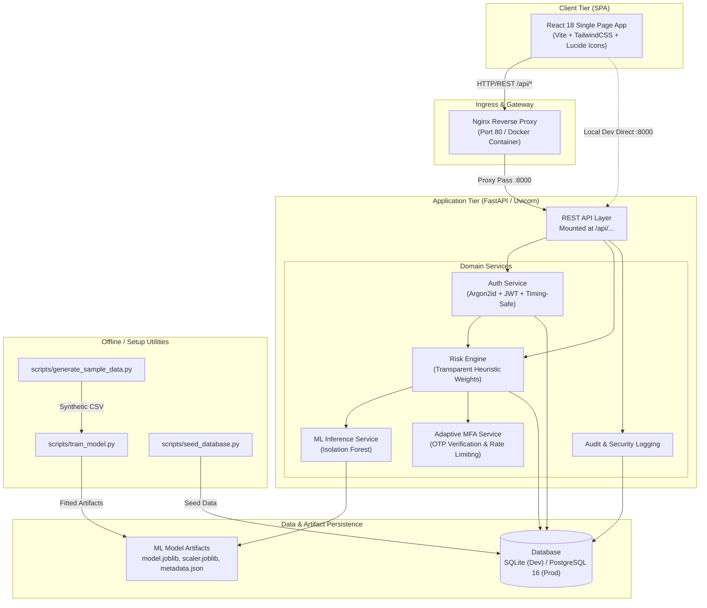
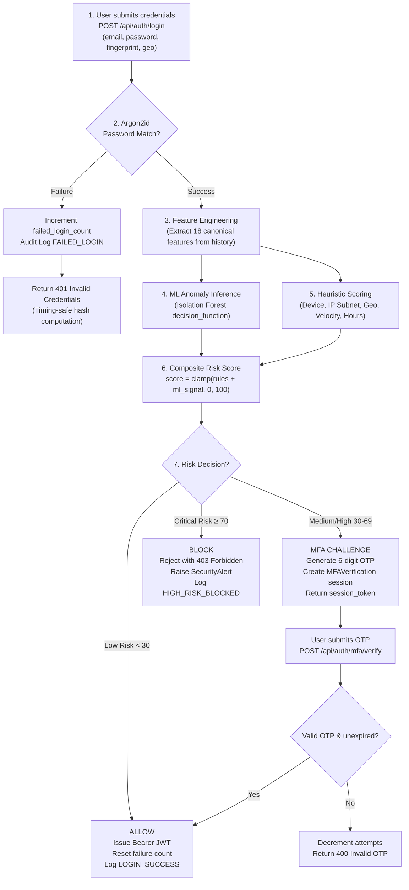
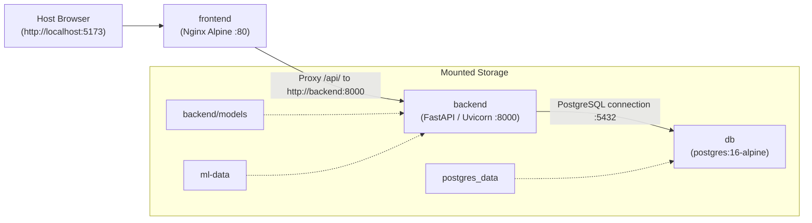

# System Architecture & Technical Design

> [!NOTE]
> This document details the software architecture, runtime topology, data flow, and honest operational boundaries of the AI-ATO Detection Platform.

---

## High-Level System Architecture

---

## Authentication & Risk Decision Pipeline

Every authentication attempt follows an adaptive decision pipeline combining heuristic rule evaluation with machine learning anomaly detection:

---

## Runtime Topology (Docker Compose)

In a containerized deployment, services communicate across an isolated internal bridge network:

---

## Honest Operational Boundaries & Caveats

> [!CAUTION]
> This platform is engineered for educational demonstration, architecture showcases, and security portfolio presentation. It is **not** a production-certified security perimeter.

| Architectural Component | Engineering Implementation | Honest Operational Boundary |
|-------------------------|----------------------------|-----------------------------|
| **ML Anomaly Detection** | Isolation Forest on 18 features | Trained strictly on **synthetic, parametric data**. Real-world attack traffic contains complex noise and zero-days not represented in the generator. |
| **Risk Scoring Weights** | Transparent additive point model | Weights (e.g. 15 pts for new device, 30 pts for ML) are **heuristically defined** rather than learned via maximum likelihood estimation on labeled breach data. |
| **Geo-Location** | In-memory lookup table + Haversine | Uses synthetic IP range mappings for deterministic tests. Production environments require MaxMind GeoIP2 or commercial IP intelligence APIs. |
| **Step-Up MFA** | Cryptographic OTP with Argon2id hash | Dev environment logs OTP to console and returns session tokens. Production requires an external SMS/Email gateway (Twilio, SendGrid) and TOTP authenticator integration. |
| **Behavioral Biometrics** | Vector fields defined in schema | Client-side keystroke dynamics and mouse movement collectors are not bundled in the default React demo forms. |
| **Single Tenant Baseline** | Local SQLite / PostgreSQL | Scoring assumes a single organization context rather than multi-tenant federated identity provider scale. |
