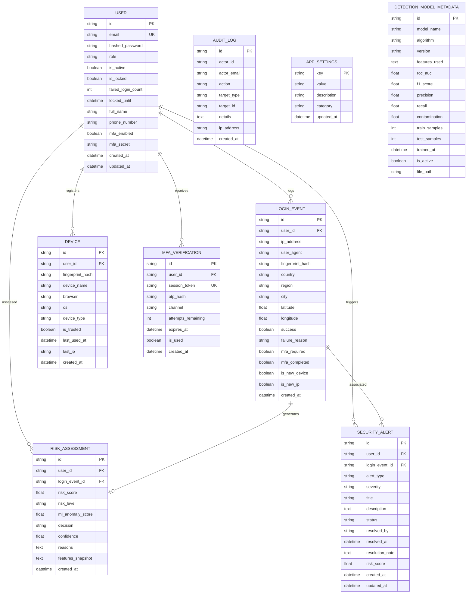

# Database Design & Schema Architecture

---

## Entity-Relationship Diagram

---

## Core Table Catalog

### 1. `users`
Primary identity and authentication table. Passwords are encrypted with Argon2id hashes.
- `role`: Role-based access control (`admin`, `analyst`, `user`).
- `failed_login_count`, `is_locked`, `locked_until`: Brute-force mitigation and account lockout mechanisms.
- `mfa_enabled`, `mfa_secret`: Per-user MFA enforcement and TOTP secret storage.

### 2. `login_events`
Immutable append-only ledger capturing all authentication traffic.
- Records rich client telemetry: IP address, raw User-Agent, browser fingerprint hash, and resolved geolocation coordinates (latitude/longitude, country, region, city).
- Records auth result (`success`, `failure_reason`, `mfa_required`, `mfa_completed`) and novelty flags (`is_new_device`, `is_new_ip`).

### 3. `risk_assessments`
Stores the analytical evaluation output for each login event (one-to-one with `login_events`).
- `risk_score`: Normalized composite score [0, 100].
- `risk_level`: Tiered category (`low`, `medium`, `high`, `critical`).
- `ml_anomaly_score`: Raw output from Isolation Forest inference.
- `decision`: Adaptive auth action (`allow`, `mfa`, `block`).
- `reasons`: Serialized JSON array of contributing factors with point values and human-readable explanations.
- `features_snapshot`: JSON dump of the 18 extracted features at evaluation time.

### 4. `devices`
Tracks persistent client fingerprints per account.
- `fingerprint_hash`: Client-side generated hash combining screen geometry, canvas, platform, and browser attributes.
- `is_trusted`: Analyst/user verification flag.
- Enables detection of `is_new_device` and `browser_changed`/`os_changed` signals.

### 5. `security_alerts`
Triage queue for SOC analysts. Triggered when high or critical risk thresholds are crossed or attack rules fire (e.g., `IMPOSSIBLE_TRAVEL`, `CREDENTIAL_STUFFING`).
- Lifecycle status: `open` → `investigating` → `resolved` / `false_positive`.
- Tracks analyst assignment, resolution timestamps, and case notes.

### 6. `audit_logs`
Immutable compliance and administrative event log.
- Records actions such as user creation, role changes, account unlocking, threshold overrides, and alert resolutions.
- Captures actor identity, IP address, and payload snapshots.

### 7. `app_settings`
Key-value configuration store for runtime parameter tuning.
- Categories: `risk_thresholds`, `weights`, `mfa`, `rate_limits`.
- Allows security administrators to adjust scoring weights without server redeployment.

### 8. `mfa_verifications`
State management for step-up multi-factor authentication challenges.
- `session_token`: Temporary short-lived token provided to the client when risk assessment dictates `decision == "mfa"`.
- `otp_hash`: Argon2id hashed 6-digit one-time password.
- Enforces strict expiry (`expires_at`) and retry limits (`attempts_remaining`).

### 9. `model_metadata`
Versioned historical catalog of trained machine learning models, recording training timestamps, hyperparameters, sample counts, and validation evaluation metrics.

---

## Indexing Strategy & Performance Considerations

| Table | Index Columns | Purpose |
|-------|---------------|---------|
| `login_events` | `user_id` | Accelerates user login history lookups for baseline feature extraction |
| `login_events` | `created_at` | Optimizes time-window filtering for velocity queries (last 15m, 1h, 24h) |
| `login_events` | `user_id, created_at` | Composite index for rolling baseline calculations |
| `risk_assessments` | `login_event_id` | One-to-one relationship join speed |
| `risk_assessments` | `created_at` | Dashboard trend aggregation and time-series reporting |
| `security_alerts` | `status, severity` | Optimizes analyst queue filtering and open alert counts |
| `security_alerts` | `user_id` | Rapid incident response lookups per user |
| `devices` | `user_id, fingerprint_hash` | O(1) device recognition check during authentication |
| `mfa_verifications`| `session_token` | High-speed lookup during OTP verification POST |
| `audit_logs` | `created_at` | Compliance audit range queries |

---

## Storage Engine Compatibility: SQLite vs PostgreSQL

The data layer uses SQLAlchemy 2.x declarative models engineered for dual-environment operation:

- **Local Development / Testing**: SQLite 3 (file or `:memory:` via `NullPool`). Uses `String(36)` for UUID keys and serialized text for JSON fields.
- **Production Deployment**: PostgreSQL 16 Alpine (via Docker Compose). Fully supports native concurrency, transactions, and index types.
