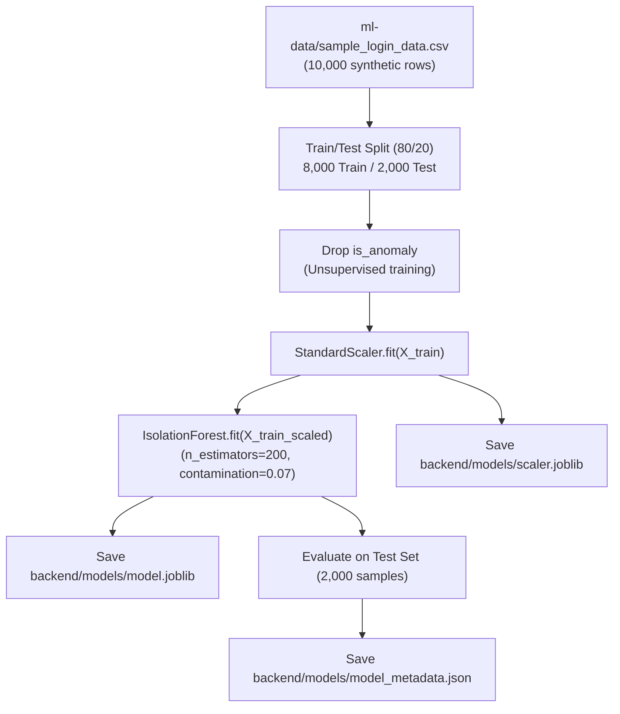

# ML Methodology & Anomaly Detection

> [!IMPORTANT]
> All machine learning models in this platform are trained and validated exclusively on **synthetic datasets**. The reported metrics (such as ROC-AUC and F1 score) demonstrate that the algorithm successfully separates the synthetic attack patterns from normal synthetic baseline activity. They should **not** be construed as guarantees of real-world production accuracy.

---

## Algorithm: Isolation Forest

### Theoretical Rationale
Account takeover (ATO) attacks often present novel vectors that deviate from legitimate user baselines. Traditional supervised classifiers suffer from severe label imbalance and vulnerability to unknown zero-day techniques.

**Isolation Forest** (`sklearn.ensemble.IsolationForest`) was selected because:
1. **Unsupervised Formulation**: Learns the geometry of normal behavioral feature space without requiring verified attack labels.
2. **Sub-Sampling & Tree Depth**: Leverages random axis-aligned splits. Anomalous observations reside in sparse regions and are isolated near the root of the trees (short path length).
3. **Low Latency Inference**: Single-sample scoring takes < 5 ms, satisfying real-time authentication pipeline requirements.
4. **Resilience to Swamping & Masking**: Efficient sub-sampling mitigates swamping (normal instances appearing anomalous) and masking (clusters of anomalies disguising each other).

The path length anomaly score is defined as:
$$s(x, n) = 2^{-\frac{\mathbb{E}(h(x))}{c(n)}}$$
where $h(x)$ is the path length in a tree and $c(n)$ is the average path length of an unsuccessful search in a Binary Search Tree constructed on $n$ samples.

---

## Canonical Feature Vector (18 Features)

The pipeline transforms raw telemetry into an 18-dimensional numeric vector (`FEATURE_NAMES` in `app/ml/feature_pipeline.py`):

| # | Feature Name | Scale / Range | Purpose |
|---|--------------|---------------|---------|
| 1 | `failed_attempts_15min` | $[0, \infty)$ | Detects credential-stuffing bursts |
| 2 | `failed_attempts_1h` | $[0, \infty)$ | Detects slow brute-force campaigns |
| 3 | `is_new_device` | $\{0, 1\}$ | Flags unfamiliar browser fingerprint |
| 4 | `is_new_ip` | $\{0, 1\}$ | Flags unfamiliar public IP |
| 5 | `is_new_ip_subnet` | $\{0, 1\}$ | Flags unfamiliar ISP /24 subnet block |
| 6 | `login_hour_sin` | $[-1.0, 1.0]$ | Cyclical temporal encoding ($\sin(2\pi \cdot \text{hour}/24)$) |
| 7 | `login_hour_cos` | $[-1.0, 1.0]$ | Cyclical temporal encoding ($\cos(2\pi \cdot \text{hour}/24)$) |
| 8 | `is_unusual_hour` | $\{0, 1\}$ | Binary indicator for off-hours login |
| 9 | `logins_last_hour` | $[0, \infty)$ | Short-term velocity metric |
| 10 | `logins_last_24h` | $[0, \infty)$ | Daily velocity metric |
| 11 | `seconds_since_last_login_log` | $[0, \infty)$ | Natural log of elapsed time since last active session |
| 12 | `geo_distance_km` | $[0, 20000]$ | Haversine distance from previous known geocoordinates |
| 13 | `country_changed` | $\{0, 1\}$ | Geolocation cross-border indicator |
| 14 | `impossible_travel_flag` | $\{0, 1\}$ | Flags speed exceeding 800 km/h between logins |
| 15 | `browser_changed` | $\{0, 1\}$ | Mismatch against user's primary browser profile |
| 16 | `os_changed` | $\{0, 1\}$ | Mismatch against user's primary OS profile |
| 17 | `ua_rarity_score` | $[0.0, 1.0]$ | Heuristic user-agent rarity weight |
| 18 | `deviation_from_baseline` | $[0.0, 1.0]$ | Statistical deviation from historical user habits |

---

## Training Pipeline & Reproducibility

The training workflow is orchestrated by `scripts/train_model.py`:



### Model Hyperparameters
- **Estimators (`n_estimators`)**: `200`
- **Contamination**: `0.07` (tuned to the 7% anomaly injection rate in `generate_sample_data.py`)
- **Max Samples (`max_samples`)**: `'auto'` ($\min(256, n)$)
- **Random State (`random_state`)**: `42`

---

## Evaluation Results (Synthetic Validation Set)

The model was evaluated against 2,000 held-out synthetic test records labeled with ground-truth anomalies (`is_anomaly`):

```json
{
  "algorithm": "IsolationForest",
  "version": "1.0.0",
  "n_features": 18,
  "train_samples": 8000,
  "test_samples": 2000,
  "contamination": 0.07,
  "roc_auc": 1.0,
  "f1_score": 1.0,
  "precision": 1.0,
  "recall": 1.0,
  "train_duration_seconds": 0.28
}
```

| Metric | Synthetic Score | Real-World Expectation |
|--------|-----------------|------------------------|
| **ROC-AUC** | `1.000` | Typically 0.85–0.93 on noisy enterprise logs |
| **F1 Score** | `1.000` | Typically 0.75–0.85 due to edge-case overlap |
| **Precision** | `1.000` | Lower in practice due to VPNs and traveling executives |
| **Recall** | `1.000` | Lower against low-and-slow targeted attacks |
| **Training Time** | `0.28 seconds` | Scales linearly with larger datasets |

---

## Runtime Inference & Model Registry

Inference is managed via a thread-safe singleton (`app/ml/model_registry.py`):
1. **Startup Loading**: `model_registry.load_model()` reads `model.joblib` and `scaler.joblib` into memory. If absent, it automatically triggers `scripts.train_model.train_and_save()`.
2. **Feature Standardisation**: Raw input arrays are passed through the fitted `StandardScaler`.
3. **Scoring**: `model.decision_function(X_scaled)` calculates the raw distance to the separating hyperplanes.
4. **Fallback Safety**: If the model files cannot be loaded, the registry reports `model_loaded=False` and the scoring engine safely falls back to rule-based scoring without interrupting authentication.

---

## Limitations & Honest Caveats

> [!WARNING]
> - **Synthetic Ceiling**: The perfect 1.000 metrics reflect distinct parameter distribution boundaries in the synthetic generator, not supernatural detection capability.
> - **Adversarial Evasion**: Attackers who harvest residential proxies matching the victim's ISP and subnet will evade geo and IP anomaly indicators.
> - **Behavioral Cold Start**: For new accounts without historical login logs, default population baselines are used, temporarily dampening personalized anomaly sensitivity.
